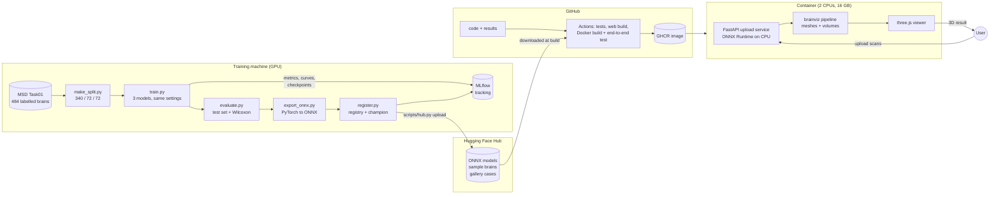

# 3D Brain Tumor Segmentation: Model Benchmark, MLOps Pipeline & Interactive 3D Viewer


An end-to-end project that takes brain MRI scans, finds the tumour in 3D, and shows the result in an interactive
3D viewer in the browser. It covers the whole life of a machine-learning model:

1. **Benchmark:** three 3D segmentation networks (SegResNet, Swin UNETR, SegFormer3D) trained under identical
   settings and compared on a held-out test set with statistical tests.
2. **MLOps:** experiment tracking and a model registry in MLflow, export to ONNX, a champion model chosen on
   accuracy *and* cost, unit tests, a Docker image, and a GitHub Actions pipeline that builds and tests that image
   end to end under the same limits as the deployment target.
3. **Serving:** a FastAPI service where anyone can upload their own scans, pick a model, and get the result back
   in a few seconds on CPU only.
4. **Visualisation:** a three.js viewer with photo-like and non-photorealistic (toon, pencil hatching) styles,
   MRI slices, and a side-by-side comparison of the model against the expert's outline.

> **Not a medical device.** Research and education only.

## Project links

| Where | What's there |
|---|---|
| **GitHub** (this repo) | All code, results, tests, Dockerfile and the CI/CD pipeline; the built container image under *Packages* |
| [**Hugging Face: models and demo data**](https://huggingface.co/MohammadSakibHossain/brain-tumor-segmentation-mlops) (public) | The three ONNX models with their specs and scores, the 4 sample brains to try the upload, and the 6 gallery brains for the 3D viewer. Docker and CI download from here |
| [**Hugging Face: training backup**](https://huggingface.co/MohammadSakibHossain/brain-tumor-segmentation-training) (private) | PyTorch checkpoints, the full MLflow history and model registry, test predictions and logs, restorable with `scripts/backup.py` |

---

## Contents

- [Project links](#project-links)
- [Background in plain words](#background-in-plain-words)
- [Results](#results)
- [How it all fits together](#how-it-all-fits-together)
- [Repository layout](#repository-layout)
- [File-by-file reference](#file-by-file-reference)
- [Stage 1: data and splits](#stage-1-data-and-splits)
- [Stage 2: training](#stage-2-training)
- [Stage 3: evaluation](#stage-3-evaluation)
- [Stage 4: ONNX export and the model registry](#stage-4-onnx-export-and-the-model-registry)
- [Stage 5: the upload service (API)](#stage-5-the-upload-service-api)
- [Stage 6: the 3D viewer](#stage-6-the-3d-viewer)
- [Stage 7: tests, Docker and CI/CD](#stage-7-tests-docker-and-cicd)
- [Limitations](#limitations)
- [Credits and licences](#credits-and-licences)
- [Run it locally](#run-it-locally)

---

## Background in plain words

**The scans.** Each patient has four MRI scans of the same head, taken with different settings. Each one shows
different tissue clearly:

| Scan | Short name | What it shows well |
|---|---|---|
| FLAIR | `t2f` | swelling around the tumour (bright) |
| T1 | `t1n` | overall anatomy |
| T1 with contrast agent | `t1c` | the *active* part of the tumour, where the dye leaks in (bright ring) |
| T2 | `t2w` | fluid and swelling |

Every scan is a 3D grid of 240 × 240 × 155 voxels (3D pixels) of 1 mm each, with the skull already removed.

**The tumour has three parts**, nested inside each other like layers of an onion:

| Zone (what the viewer draws) | Plain meaning | Colour in the viewer |
|---|---|---|
| Edema | swelling around the tumour | yellow |
| Non-enhancing / necrotic | inactive or dead tumour tissue | purple |
| Enhancing | active, growing tumour | red |

**What the models predict.** Doctors and the BraTS challenge score three *regions*, each containing the one inside it:

| Region | = zones | Why it matters |
|---|---|---|
| **WT**, whole tumour | swelling + inactive + active | total extent of the disease |
| **TC**, tumour core | inactive + active | what a surgeon would remove |
| **ET**, enhancing tumour | active | what is growing; followed during treatment |

So every model takes **4 scans in** and gives **3 yes/no maps out** (one per region). The zones the viewer draws
are worked out from the regions (`edema = WT − TC`, `non-enhancing = TC − ET`, `enhancing = ET`).

**How "good" is measured.**
- **Dice:** overlap between the model's region and the expert's region, from 0 (no overlap) to 1 (identical).
- **HD95:** how far the model's edge strays from the expert's edge, in mm (95th percentile, so one stray voxel
  doesn't dominate). Lower is better. A region the model misses completely, or invents, counts as 373 mm
  (the diagonal of the scan).
- **Sensitivity:** how much of the real tumour was found. **Precision:** how much of what was marked is really tumour.

---

## Results

Held-out **test set of 72 brains** that no model saw during training or model selection.

| Model | Dice WT | Dice TC | Dice ET | **Mean Dice** | HD95 ET (mm) | Parameters | CPU time per brain* | GPU memory (training) | Training time |
|---|---|---|---|---|---|---|---|---|---|
| **SegResNet** ★ champion | 0.899 | 0.833 | 0.772 | **0.835** | 16.7 | 4.7 M | 7.1 s | 2.95 GB | 2.8 h |
| Swin UNETR | 0.898 | 0.829 | 0.779 | **0.835** | 16.4 | 62.2 M | 31.3 s | 12.8 GB | 13.8 h |
| SegFormer3D | 0.889 | 0.815 | 0.736 | **0.813** | 10.2 | 4.5 M | 1.4 s | 1.9 GB | 0.8 h |

\* ONNX Runtime, 2 CPU threads (the size of a free Hugging Face Space). Training on one NVIDIA RTX A6000 (48 GB).

**Statistics** (Wilcoxon signed-rank test on per-brain mean Dice, paired by brain):
- SegResNet vs Swin UNETR: **p = 0.42**, no real difference.
- SegResNet vs SegFormer3D and Swin UNETR vs SegFormer3D: **p < 0.0001**, SegFormer3D is genuinely less accurate.

**Champion: SegResNet.** It ties Swin UNETR on accuracy with 13× fewer parameters, runs 4× faster on CPU and needs
4× less GPU memory. SegFormer3D is kept as the "fast option" (5× faster than SegResNet, 2 Dice points lower).

**Over-fitting check** (mean Dice on each split, from `results/*/test_summary_{train,val}.json`):

| Model | Training brains (340) | Validation brains (72) | Test brains (72) |
|---|---|---|---|
| SegResNet | 0.858 | 0.809 | 0.835 |
| Swin UNETR | 0.886 | 0.810 | 0.835 |
| SegFormer3D | 0.848 | 0.786 | 0.813 |

All three score higher on brains they trained on (expected), and Swin UNETR, the largest model, has the biggest gap.
The test score is not lower than validation, so picking the best checkpoint on validation brains didn't inflate it.

Full per-metric table: [`results/comparison.md`](results/comparison.md) ·
per-brain scores: `results/<model>/test_per_case.csv` · interactive charts: the viewer's **Models** page.

---

## How it all fits together



**In words:**

1. The dataset is split once into training, validation and test brains with a fixed random seed.
2. Each model is trained with the *same* data pipeline, loss, optimiser and schedule; only the network changes.
   Every run is logged to MLflow.
3. The best checkpoint of each model (chosen on validation) is scored once on the test brains.
4. The checkpoints are converted to ONNX so they run on CPU without PyTorch, checked to give the same answer,
   timed, and registered in MLflow with the champion marked.
5. Big files (models, sample scans, gallery) go to the Hugging Face Hub; code and small results go to GitHub.
6. On every push, GitHub Actions runs the unit tests, builds the viewer, builds the Docker image (which downloads
   the models from the Hub), starts it with 2 CPUs and 16 GB, uploads a real brain to it and checks the answer.
7. In the container, the API runs the chosen model on an upload, turns the result into 3D meshes with the
   `brainviz` pipeline, and the viewer shows them.

---

## Repository layout

```
.
├── ml/                     training, evaluation, export, registry (PyTorch + MONAI)
│   ├── configs/            YAML settings: base.yaml shared by all models + one small file per model
│   ├── models/             model factory + SegFormer3D source
│   ├── data.py             dataset split loading + preprocessing / augmentation
│   ├── train.py            training loop, validation, checkpoints, MLflow logging
│   ├── evaluate.py         test-set scoring, statistics, box plot
│   ├── metrics.py          Dice / HD95 / sensitivity / precision (shared with the API)
│   ├── inference.py        crop → normalise → sliding window → paste back; PyTorch and ONNX
│   ├── export_onnx.py      PyTorch → ONNX + agreement check + CPU timing
│   ├── register.py         MLflow model registry + models/manifest.json
│   └── fingerprint.py      recognise uploads that are dataset brains
├── pipeline/brainviz/      MRI + labels → 3D files for the viewer (installable package)
├── api/                    FastAPI upload service + end-to-end client test
├── web/                    TypeScript + three.js viewer and Models page (Vite)
├── scripts/                one-off tools: download, split, gallery, samples, models page, Hub sync
├── tests/                  pytest unit tests (synthetic data, no dataset needed)
├── results/                every score and curve behind the numbers above
├── splits/                 the fixed data split + dataset fingerprints
├── models/                 model metadata (*.json); the *.onnx files live on the Hugging Face Hub
├── notebooks/              first look at the dataset
├── requirements/           pinned package versions (api.txt for serving, train.txt for training)
├── Dockerfile              one image: viewer + API + models
└── .github/workflows/ci.yml
```

Not in git (see `.gitignore`): the dataset (`data/`), checkpoints and predictions (`output/`), MLflow's database
(`mlflow.db`, `mlruns/`), the ONNX files, and the viewer's generated gallery (`web/public/cases/`).

---

## File-by-file reference

### `ml/`: the machine-learning code

| File | Purpose | Main contents |
|---|---|---|
| `configs/base.yaml` | Settings shared by **every** model, so the comparison is fair | seed 42; 160³ crops, batch 2; 30,000 steps; AdamW lr 1e-4, weight decay 1e-5; 500 warm-up steps then cosine decay; bfloat16 mixed precision; validate every 1,000 steps |
| `configs/segresnet.yaml`, `swin_unetr.yaml`, `segformer3d.yaml` | Pick the network; nothing else may change | `model.name`; Swin UNETR also sets `use_checkpoint: true` (recompute activations to save GPU memory) |
| `models/__init__.py` | One factory that builds any of the three networks with identical in/out shapes | `build_model(name)` → 4 input channels, 3 output channels; `MODEL_NAMES` |
| `models/segformer3d.py` | SegFormer3D network, copied from the authors' repository (GPL-3.0) | `SegFormer3D`, `MixVisionTransformer`, `SegFormerDecoderHead`; one change: removed a `@torch.jit.script` that fails on PyTorch 2.11 |
| `data.py` | Loading and preprocessing, shared by training, validation, test and the API | `ConvertMSDToRegionsd` (labels 0–3 → WT/TC/ET masks); `base_transforms` (load → regions → crop to brain → normalise brain voxels to mean 0 / std 1 → pad to 160³); `train_transforms` (adds random 160³ crops, half centred on tumour, random flips on all 3 axes, ±10% contrast and brightness); `get_cases`, `get_loaders` (cached datasets) |
| `train.py` | Trains one model from a config | `DiceCELoss` (Dice + cross-entropy, sigmoid per region); `warmup_cosine` schedule; `validate` (full-brain sliding window, Dice + loss every 1,000 steps); keeps `best.pt` (highest validation Dice); logs parameters, metrics, curves, example images and the git commit to MLflow |
| `inference.py` | Turns a whole brain into a prediction; used by evaluation **and** the API so both see identical inputs | `predict` (crop to the brain's bounding box → normalise → 160³ sliding window with 50% overlap → paste back to full size); `load_model` (PyTorch checkpoint); `OnnxModel` / `load_onnx` (ONNX Runtime, memory arena off, one window at a time); `regions_to_labels` (regions → label map 1/2/3) |
| `metrics.py` | The scores, in one place | `region_metrics(pred, true, spacing)` → Dice, HD95, sensitivity, precision; `MISSED_HD95 = 373.13` mm for a missed or invented region |
| `evaluate.py` | Scores the best checkpoints on a split | `--split test/val/train`, `--save-preds`, `--plots-only`; writes `results/<model>/test_per_case*.csv` and `test_summary*.json`, `results/comparison.md/json` (with Wilcoxon tests), `results/test_dice_boxplot.png`; logs test runs to MLflow |
| `export_onnx.py` | PyTorch → ONNX for CPU serving | dynamo exporter, opset 18, fixed input `1×4×160×160×160`; checks the ONNX model gives the same masks as PyTorch (Dice 0.998 / 0.994 / 0.983 for SegResNet / Swin UNETR / SegFormer3D); times CPU inference at 2 and 8 threads; writes `models/<model>.onnx` + `.json` |
| `register.py` | Model registry | registers each ONNX model as a version of `brain-tumour-seg` in MLflow, sets aliases (`@champion`, `@segresnet`, …) and writes `models/manifest.json` with the champion, the reason, file checksums, test Dice and CPU speed |
| `fingerprint.py` | Recognises a dataset brain when someone uploads it | `build()` hashes every scan's voxel values (SHA-256, after putting it in a standard orientation) into `splits/msd_fingerprints.json`; `identify(scans)` → case id, which split it came from, and what that means for trusting the score |

### `pipeline/brainviz/`: from MRI to 3D files

An installable package (`pipeline/pyproject.toml`, command `brainviz`) used by the gallery builder and the API.

| File | Purpose | Main contents |
|---|---|---|
| `io.py` | Read a case from disk | `Case` (scans + regions + affine + spacing); `load_msd_case` (one 4D file: FLAIR, T1, T1c, T2); `load_brats_case` (one file per scan; understands 2021 and 2023 file names); `MSD_CHANNELS` |
| `labels.py` | Label numbers ↔ regions ↔ zones, for each dataset | `regions_from_msd` (1 swelling, 2 inactive, 3 active); `regions_from_brats` (1 inactive, 2 swelling, 4 or 3 active); `zones_from_regions` (always consistent, even when a model's regions aren't nested); `ZONES` (names + colours) |
| `meshing.py` | Voxel masks → smooth 3D surfaces | `brain_mask`; `mask_to_mesh` (light blur → marching cubes → place in millimetres with the scan's affine → simplify to a face budget). If blurring removes everything (scattered specks), it meshes the raw voxels instead |
| `export.py` | Write the files the viewer loads | `write_glb` (meshes → binary glTF); `write_volumes` (each scan → 8-bit, gzip-compressed volume for the slice view); `normalise_to_uint8`; `zone_info`; `BUNDLE_VERSION = 3` |
| `build.py` | Put a whole case together | `build_bundle` (brain surface + volumes + segmentations + `meta.json`); `write_segmentation` (tumour zones `seg_<source>.glb` and, when an expert outline exists, the differences `diff_<source>.glb`: missed vs extra tumour); `add_segmentation` (add another model's result to an existing case) |
| `cli.py` | Command line | `brainviz msd BRATS_001 --out output/bundles`, `brainviz brats path/to/case` |

**A viewer "bundle"** (one folder per case): `brain.glb`, `seg_<source>.glb` and `diff_<source>.glb` for each
segmentation (`expert`, `segresnet`, …), `volume_<scan>.bin.gz` for each MRI scan, and `meta.json` describing
them (zones, sizes, which segmentation is the default, scores if known).

### `api/`: the upload service

| File | Purpose | Main contents |
|---|---|---|
| `main.py` | FastAPI app: queue, models, endpoints, static viewer | one background worker thread working through a job queue; `run_job` (read upload → run model → build bundle → score against the expert outline if given); `run_extra_model` (run another model on an earlier upload); `get_model` (keeps SegResNet and SegFormer3D loaded, loads Swin UNETR per job and frees it afterwards); `restore_jobs` (finished jobs survive a restart); `clean_old_jobs` (deletes uploads after 6 h); serves `web/dist` if present |
| `uploads.py` | Read and check uploads, with clear error messages | `load_upload(scans, label, label_format)` accepts one 4-in-1 MSD file or four BraTS files; checks matching sizes, ~1 mm spacing, finite values, skull removed, scans overlap; works out the label numbering (a 4 means BraTS; otherwise the user's choice or the scans' format); `UploadError` |
| `test_api.py` | End-to-end test of a running server, used in CI | (1) one MSD file + expert outline with two models: recognised as test brain BRATS_075, champion shown first, files served, no path escape; (2) four BraTS files without outline: champion used by default; (2b) a second model run on that upload afterwards, and running it twice refused; (3) mistakes (unknown model, missing scans, wrong file type) each get a clear `400` message |
| `__init__.py` | makes `api` importable | |

**Endpoints**

| Method & path | What it does |
|---|---|
| `GET /api/health` | liveness check (used by Docker's `HEALTHCHECK` and CI) |
| `GET /api/models` | the three models with display name, test Dice, CPU time, champion flag |
| `POST /api/segment` | upload `scans` (one MSD file) **or** `flair`, `t1`, `t1ce`, `t2`; optional `label`, `label_format`; `models` to run. Returns `202` with a job id |
| `POST /api/jobs/{id}/models` | run another model on an earlier upload (`409` if already run, `410` if the upload has expired) |
| `GET /api/jobs/{id}` | job status, progress, scores, and where to find the result |
| `GET /api/cases/{id}/{file}` | the result's bundle files for the viewer |

**Settings** (environment variables): `BRAIN_MODELS_DIR`, `BRAIN_JOBS_DIR`, `BRAIN_WEB_DIR`, `BRAIN_FINGERPRINTS`,
`BRAIN_THREADS` (ONNX threads), `BRAIN_MAX_UPLOAD_MB`, `BRAIN_JOB_TTL_HOURS`, `BRAIN_ALLOWED_ORIGINS` (CORS),
`BRAIN_KEEP_LOADED` (models kept in memory).

### `web/`: the viewer

| File | Purpose | Main contents |
|---|---|---|
| `index.html` | Viewer page | layout, side panel (display, segmentation, comparison, slice controls), sample gallery, "Try your own scans" upload box |
| `models.html` | Models page | model cards, test table, charts, method notes |
| `src/main.ts` | Viewer logic | three.js scene and camera; loads a bundle; segmentation dropdown (expert + each model, or "run another model" for uploads); expert-vs-model comparison (missed tumour in blue, extra tumour in orange, expert outline in grey, each switchable); MRI slice with brightness/contrast; shareable links (`?case=…&seg=…&cmp=…&scan=…&style=…&slice=…&zoom=…` or `?job=…`); upload with two drop boxes (scans, label), progress bar and job polling |
| `src/npr.ts` | Non-photorealistic rendering | toon shading with outlines; pencil hatching (triplanar strokes whose density follows the lighting, adjustable spacing); realistic style |
| `src/slice.ts` | MRI slice plane | decodes a gzip volume, shows one slice in 3D at the chosen depth, `setLevels(brightness, contrast)` |
| `src/charts.ts` | Small SVG chart library (no dependencies) | `lineChart` (training curves, best-checkpoint markers, crosshair), `boxChart` (per-brain Dice with outliers linking to the viewer), `scatterChart` (accuracy vs speed, log axis), `legend` |
| `src/models.ts` | Models page logic | reads `public/data/models.json`, draws the test table, box plot, accuracy-vs-speed chart, validation Dice and loss curves, train/val/test table with a plain-language explanation, efficiency table |
| `public/data/models.json` | Data for the Models page | generated by `scripts/build_models_page.py` |
| `public/data/try.json` | The sample brains offered for download | generated by `scripts/make_samples.py` |
| `vite.config.js` | Build tool settings | multi-page build (viewer + Models page); dev proxy `/api` → `localhost:8000` |
| `package.json`, `package-lock.json`, `tsconfig.json` | Node dependencies (three.js, Vite, TypeScript) and compiler settings | `npm run build` = type check + bundle into `web/dist` |

### `scripts/`: one-off tools

| File | Purpose |
|---|---|
| `download_msd.py` | Downloads and extracts MSD Task01 BrainTumour (~7 GB) with checksum verification |
| `make_split.py` | Makes the fixed split: 484 labelled brains shuffled with seed 42 → 72 test, 72 validation, 340 training → `splits/msd_split.json` |
| `check_data.py` | Sanity check of the data pipeline: shapes, label values, a picture, and whether loading keeps up with the GPU |
| `timing_test.py` | Measures each network's training and prediction speed and GPU memory on random data, before committing to long runs |
| `train_all.sh` | Trains the three models one after another (fastest first, so a bug shows up in minutes) |
| `build_gallery.py` | Builds the viewer's gallery: six chosen test brains (largest, typical, mostly swelling, smallest, models disagree, a failure), each with the expert outline and all three models → `web/public/cases/` |
| `make_samples.py` | Packs four test brains (4 scans in one file + expert outline) for users to download and try the upload |
| `build_models_page.py` | Collects training curves (training loss averaged per 1,000 steps), test results, per-split Dice and statistics → `web/public/data/models.json` |
| `hub.py` | Uploads / downloads the large files to / from the Hugging Face Hub (`upload`, `card`, `download --what models samples cases`) |
| `hub_model_card.md` | The description page of the public Hugging Face model repo |
| `backup.py` | Backs up / restores what exists only on the training machine (PyTorch checkpoints, MLflow database and run files, test predictions, logs) to a private Hugging Face repo, with checksums; `restore` rewrites MLflow's stored folder paths so the history works on a new machine |

### `tests/`: unit tests (pytest, 24 tests, ~5 s, no dataset or models needed)

| File | What it checks |
|---|---|
| `conftest.py` | makes a fake skull-stripped brain and saves it in MSD and BraTS layouts |
| `test_labels.py` | MSD and BraTS numbering (BraTS 2021's "4" and 2023's "3") give the same regions; unknown values are refused; zones stay consistent when a model's regions aren't nested |
| `test_meshing.py` | a ball becomes a closed surface of the right size; the affine places it in millimetres; empty or tiny masks give nothing; scattered specks no longer crash (regression test) |
| `test_uploads.py` | both upload formats read into the training scan order; label numbering is detected; missing scan, single 3D file, skull not removed, wrong spacing, not a NIfTI file and mismatched sizes are each refused with the right message |
| `test_metrics_and_inference.py` | Dice/HD95 on perfect, empty, missed and shifted predictions; fingerprints depend on voxel values not storage type; `predict` crops to the brain, feeds the model full 160³ windows only and returns a full-size result |

### Other files

| File | Purpose |
|---|---|
| `results/` | `comparison.md/json` (all metrics + statistics), `test_dice_boxplot.png`, and per model: `history.csv` (training log), `curves.png`, `test_per_case*.csv`, `test_summary*.json` for test / val / train |
| `splits/msd_split.json` | which brains are train / validation / test |
| `splits/msd_fingerprints.json` | voxel hashes of every dataset brain, so uploads can be recognised |
| `models/<model>.json` | ONNX input/output spec, training config, checkpoint step, validation/test Dice, ONNX-vs-PyTorch agreement, CPU times |
| `models/manifest.json` | registry snapshot: champion, reason, versions, checksums |
| `notebooks/01_explore_data.ipynb` | first look at one case: the four scans, the label values, the WT/TC/ET regions, and a check of which label number is the enhancing tumour (brightest on the contrast scan) |
| `requirements/api.txt` | pinned packages for serving (CPU) |
| `requirements/train.txt` | adds training, MLflow, ONNX export and test packages |
| `Dockerfile`, `.dockerignore` | the container image (see Stage 7) |
| `.github/workflows/ci.yml` | the CI/CD pipeline (see Stage 7) |

---

## Stage 1: data and splits

- **Dataset:** [Medical Segmentation Decathlon](http://medicaldecathlon.com/) Task01 BrainTumour, 484 labelled brains
  (from BraTS 2016/2017) plus 266 unlabelled ones. Labels: `1` swelling, `2` inactive tumour, `3` active tumour.
- **Split** (`scripts/make_split.py`): shuffled once with seed 42 using a private random generator, then
  **340 training / 72 validation / 72 test**. The test brains are touched exactly once, at the end.
- **Fingerprints** (`ml/fingerprint.py`): a hash of every scan's voxel values. When someone uploads a dataset brain,
  the service recognises it and says honestly whether the model *trained* on it (score will look optimistic),
  used it for model selection, or never saw it (a fair score). Three pairs of the unlabelled brains turned out to be
  duplicates of each other.

## Stage 2: training

Same recipe for all three networks (`ml/configs/base.yaml`), so differences come from the network alone:

| Setting | Value | Why |
|---|---|---|
| Input | random 160³ crops of the 4 scans, batch 2 | a whole brain doesn't fit through Swin UNETR in GPU memory; half the crops are centred on tumour so the model sees enough of it |
| Augmentation | flips on all 3 axes, ±10% contrast, ±0.1 brightness | more variety from 340 brains |
| Loss | Dice + cross-entropy (`DiceCELoss`, sigmoid per region) | Dice handles the tiny tumour vs huge background; cross-entropy keeps early training stable |
| Optimiser | AdamW, lr 1e-4, weight decay 1e-5 | standard for these networks |
| Schedule | 500-step linear warm-up, then cosine decay over 30,000 steps (~176 epochs) | |
| Precision | bfloat16 mixed precision | about 2× faster, half the memory |
| Validation | every 1,000 steps on all 72 validation brains, whole-brain sliding window | the checkpoint with the best validation Dice is kept |

Best checkpoints: SegResNet at step 15,000, Swin UNETR at 20,000, SegFormer3D at 24,000. Swin UNETR first ran out of
GPU memory; it was retrained with activation checkpointing (`use_checkpoint: true`), which trades ~25% speed for far
less memory without changing results.

Every run is logged to **MLflow**: all settings, the git commit, training loss every 50 steps, validation Dice and
loss, learning rate, example images and the final curves.

## Stage 3: evaluation

`ml/evaluate.py` predicts each test brain with exactly the inference code the API uses (`ml/inference.py`):
crop to the brain's bounding box, normalise, slide a 160³ window over it with 50% overlap, paste back to full size,
threshold at 0.5. It then scores WT, TC and ET per brain with `ml/metrics.py`, writes per-brain CSVs and summaries,
runs Wilcoxon signed-rank tests between every pair of models, and draws the box plot. The same run on the
validation and training brains gives the over-fitting table above.

Cropping to the brain *before* the sliding window mattered: without it, evaluation disagreed with the validation
numbers seen during training (0.802 vs 0.815) because the windows landed differently.

## Stage 4: ONNX export and the model registry

- **Export** (`ml/export_onnx.py`): each best checkpoint → ONNX (opset 18, input `scans` 1×4×160³, output `logits`
  1×3×160³). The ONNX model is checked against PyTorch on real brains (mask Dice 0.983–0.998) and timed on CPU.
  ONNX Runtime needs no PyTorch at serving time and is the industry-standard CPU runtime.
- **Registry** (`ml/register.py`): each ONNX file becomes a version of the registered model `brain-tumour-seg` in
  MLflow (v1 SegFormer3D, v2 SegResNet, v3 Swin UNETR). The `@champion` alias points at SegResNet, with the reason
  recorded. `models/manifest.json` is the same information as a file, so the API doesn't need an MLflow server.
- **Hub** (`scripts/hub.py`): the ONNX files (Swin UNETR alone is 249 MB, over GitHub's 100 MB limit), sample brains
  and gallery cases are pushed to the
  [Hugging Face Hub](https://huggingface.co/MohammadSakibHossain/brain-tumor-segmentation-mlops).

## Stage 5: the upload service (API)

```
upload ──► checks (uploads.py) ──► job queue ──► worker thread:
                                                  run model(s) on CPU (ONNX Runtime)
                                                  → regions → 3D bundle (brainviz)
                                                  → score vs expert outline, if uploaded
                                                  → recognise dataset brains (fingerprints)
browser ◄── polls GET /api/jobs/{id} ◄── status, progress, scores, bundle URL
```

- **Two upload formats:** MSD (one file with all 4 scans) or BraTS (4 files). An expert outline is optional; its
  numbering (MSD or BraTS 2021 / 2023) is detected or chosen by the user.
- **Clear refusals:** wrong file type, missing scan, scans of different sizes, wrong spacing, skull not removed, or
  scans that don't overlap each give a specific message instead of a crash or a silent bad result.
- **Run more models later:** the scans are kept with the job for 6 hours, so the user can switch to another model and
  it is computed on demand and added to the same 3D view.
- **Fits in a free 16 GB / 2 CPU server:** ONNX Runtime's memory arena is turned off (Swin UNETR peak 20.7 → 12.0 GB),
  the two small models stay loaded, and Swin UNETR is loaded only while it runs. Measured: 1.6 GB idle, 12.5 GB peak
  during a Swin UNETR job, back to 1.7 GB after.
- **Survives restarts:** finished jobs are reloaded from disk on start-up; old ones are cleaned up.

## Stage 6: the 3D viewer

Open the site and you get:

- **A sample gallery** of six test brains chosen for variety: the largest tumour, a typical one, one that is mostly
  swelling, the smallest, one where the models disagree, and one where they fail.
- **3D view:** a translucent brain with the tumour's three zones inside. Styles: **toon** (flat colours with outlines),
  **hatching** (pencil-like strokes, denser in shadow, adjustable spacing) and **realistic**.
- **Segmentation menu:** the expert outline or any of the three models; for uploads, models not yet run appear as
  "<model>: run it (about N s)" options.
- **Comparison with the expert:** tumour the model **missed** in blue, tumour it **added** in orange, and the expert's
  outline in grey, each switchable, with the brain's Dice scores.
- **MRI slice:** any of the four scans, at any depth, with brightness and contrast.
- **Shareable links:** every view is a URL (`?case=BRATS_075&seg=segresnet&cmp=1&scan=t1c&style=hatching&slice=80`).
- **Try your own scans:** drop the scans in one box and an optional expert outline in the other, pick models, upload,
  and watch progress; or download one of the four sample brains to try.
- **Models page:** model cards, the test table, per-brain box plot (click an outlier to open that brain), accuracy vs
  speed, validation Dice and loss curves, the train / validation / test table explained in plain language, and
  efficiency numbers.

## Stage 7: tests, Docker and CI/CD

**Unit tests** (`tests/`, 24 tests, ~5 s): synthetic brains only, so they run anywhere without the 7 GB dataset.

**Docker image** (`Dockerfile`), two stages:
1. `node:22-slim` builds the viewer into static files.
2. `python:3.11-slim` installs CPU-only PyTorch and the pinned `requirements/api.txt`, copies only the code the
   service needs, downloads the models, samples and gallery from the Hugging Face Hub, runs as a non-root user
   (uid 1000, as Hugging Face Spaces require), exposes port 7860 and has a health check.

**GitHub Actions** (`.github/workflows/ci.yml`), on every push and pull request:

| Job | Steps |
|---|---|
| `tests` | install CPU PyTorch + pinned packages → `pytest` |
| `web` | `npm ci` → TypeScript type check → production build |
| `docker` (after both pass) | build the image (layer cache in GitHub) → start it with `--memory 16g --cpus 2`, the same limits as the deployment target → wait for `/api/health` → download the sample brains → run `api/test_api.py` against the container → check the viewer pages are served → report memory use → on `main`, push the image to GitHub Container Registry tagged `latest` and with the commit hash |

So a change that breaks training-time preprocessing, the upload checks, the 3D pipeline, the viewer build, the
image, or memory limits is caught before it is deployed.

---

## Limitations

- **Training data is old and small:** 484 brains from BraTS 2016/2017 (pre-operative gliomas). Newer scanners,
  post-operative scans or other tumour types may do worse.
- **Mixed-up uploads can't be detected:** if the four scans come from different patients but have the same size, the
  checks pass and the result is meaningless.
- **Left/right:** the viewer shows the brain in the scanner's coordinate system; it has not been checked against a
  radiology viewer's left/right convention.
- **Scores on training brains look better than they are:** the service warns when an upload is a training brain.
- **Swin UNETR training:** run with activation checkpointing after an out-of-memory error; this does not change the
  maths, only speed.
- **CPU only in deployment:** Swin UNETR takes ~30 s per brain on 2 CPU cores.

---

## Credits and licences

- **Data:** Medical Segmentation Decathlon, Task01 BrainTumour, [CC-BY-SA 4.0](https://creativecommons.org/licenses/by-sa/4.0/).
  Simpson et al., *A large annotated medical image dataset for the development and evaluation of segmentation
  algorithms*, 2019; derived from BraTS 2016/2017 (Menze et al., 2015; Bakas et al., 2017). The sample and gallery
  brains on the Hugging Face Hub are redistributed under the same licence.
- **SegResNet:** Myronenko, *3D MRI brain tumor segmentation using autoencoder regularization*, 2018 (MONAI implementation).
- **Swin UNETR:** Hatamizadeh et al., *Swin UNETR: Swin Transformers for Semantic Segmentation of Brain Tumors in MRI
  Images*, 2022 (MONAI implementation).
- **SegFormer3D:** Perera, Navard, Yilmaz, *SegFormer3D: an Efficient Transformer for 3D Medical Image Segmentation*,
  CVPRW 2024. `ml/models/segformer3d.py` is copied from [OSUPCVLab/SegFormer3D](https://github.com/OSUPCVLab/SegFormer3D)
  and is under **GPL-3.0**.
- Built with PyTorch, MONAI, ONNX Runtime, MLflow, FastAPI, scikit-image, trimesh, three.js and Vite.

---

## Run it locally

You need about 6 GB of free disk space and 8 GB of RAM (16 GB to also run Swin UNETR). No GPU is needed.
The models, sample brains and 3D gallery (~430 MB) are downloaded automatically from the
[Hugging Face Hub](https://huggingface.co/MohammadSakibHossain/brain-tumor-segmentation-mlops).

**Option 1: Docker (easiest, one command after cloning)**

```bash
git clone https://github.com/SakibHossain9999/Brain-Tumor-Segmentation-Mlops.git
cd Brain-Tumor-Segmentation-Mlops
docker build -t brain-seg .              # first build takes ~10 minutes
docker run --rm -p 7860:7860 brain-seg
```

Open **http://localhost:7860**.

**Option 2: without Docker** (Python 3.11 and Node.js 22)

```bash
git clone https://github.com/SakibHossain9999/Brain-Tumor-Segmentation-Mlops.git
cd Brain-Tumor-Segmentation-Mlops
python -m venv .venv && source .venv/bin/activate          # Windows: .venv\Scripts\activate
pip install torch==2.11.0 --index-url https://download.pytorch.org/whl/cpu
pip install -r requirements/api.txt
python scripts/hub.py download --repo MohammadSakibHossain/brain-tumor-segmentation-mlops --samples-dir web/public/samples
cd web && npm ci && npm run build && cd ..                  # build the viewer
uvicorn api.main:app --port 8000
```

Open **http://localhost:8000**.

**Then try it:**
1. Pick a brain from the **sample gallery**, rotate it, switch the style to hatching, and turn on the comparison
   with the expert outline.
2. In **Try your own scans**, download a sample brain, drop it (and its `_seg` outline, optional) into the boxes,
   choose a model and click **Segment**. SegResNet takes about 5–10 seconds on a laptop CPU.
3. Open the **Models** page for the training curves and test results.

**For development** (live reload, tests, training packages):

```bash
pip install torch==2.11.0 --index-url https://download.pytorch.org/whl/cpu   # or a CUDA build for training
pip install -r requirements/train.txt
python scripts/hub.py download --repo MohammadSakibHossain/brain-tumor-segmentation-mlops   # models, samples, gallery

uvicorn api.main:app --port 8000 --reload                               # API (restarts on code changes)
cd web && npm ci && npm run dev                                         # viewer with live reload at http://localhost:5173
python -m pytest -q tests                                               # unit tests
```

**Reproduce the models from scratch** (NVIDIA GPU; install a CUDA build of PyTorch first):

```bash
python scripts/download_msd.py                 # ~7 GB into data/msd
python scripts/make_split.py                   # splits/msd_split.json (already in the repo)
bash scripts/train_all.sh                      # ~17 h on one RTX A6000; watch with: mlflow ui --backend-store-uri sqlite:///mlflow.db
python ml/evaluate.py --split test --save-preds
python ml/export_onnx.py
python ml/register.py --champion segresnet --reason "ties Swin UNETR, 4x faster on CPU"
PYTHONPATH=pipeline python scripts/build_gallery.py
python scripts/make_samples.py && python scripts/build_models_page.py
```
